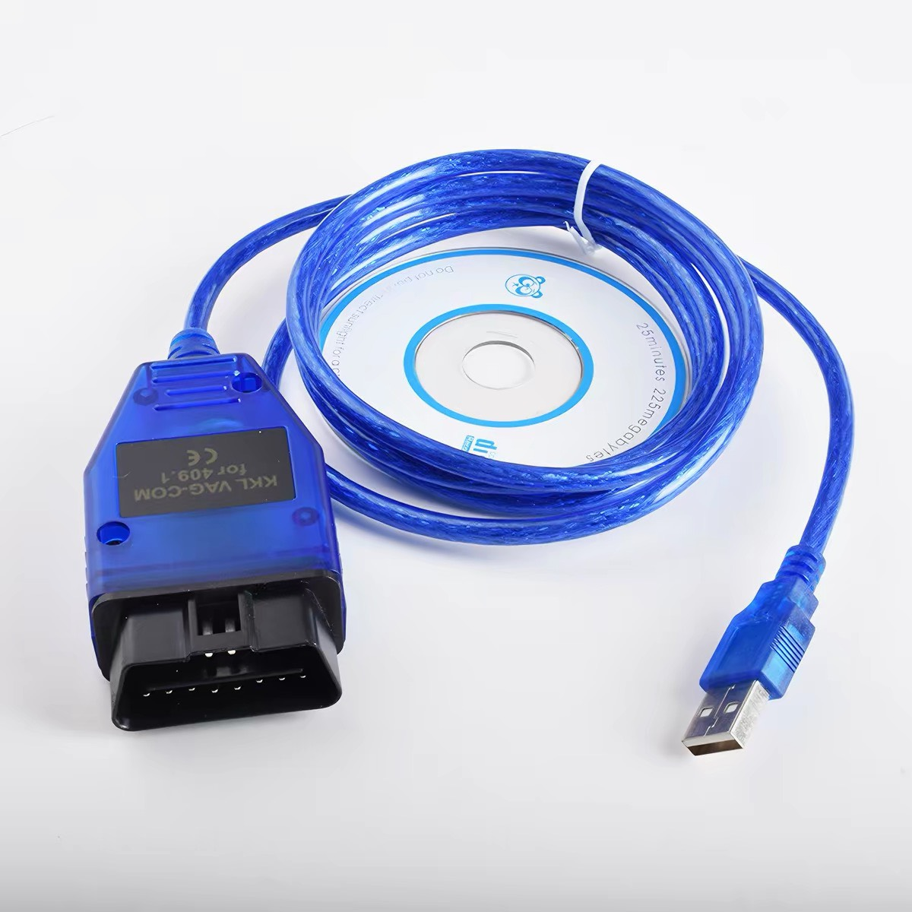
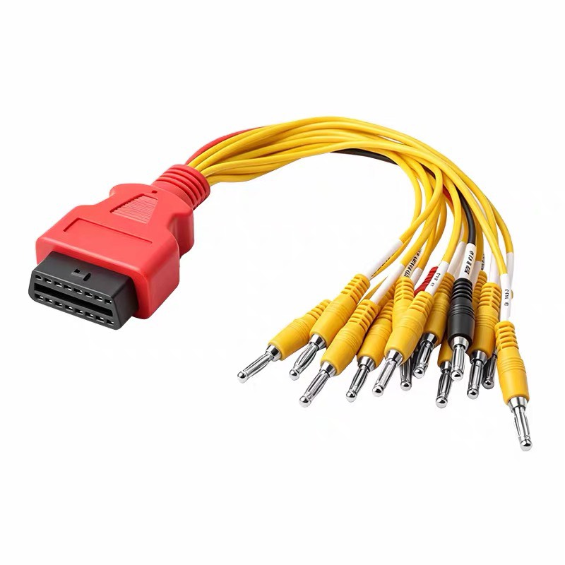

# HFMreader Lite — Experimental Public Test 1

**繁體中文：請先閱讀 [Lite 中文操作卡](LITE_START_ZH_TW.md)。這次改用較簡單的 ECU 辨識與故障碼工具，邀請車友協助蒐集成功或失敗的紀錄；尚未證實全面跨車相容。**

Free Windows software by **Pellaeon Chi** for voluntary Mercedes-Benz HFM compatibility research. Lite focuses on **ECU identification, fault-memory reading and local logs**. It also retains an explicitly confirmed experimental fault-clear operation. It is not a read-only tool and is not a replacement for a qualified diagnostic system.

## Why a simpler tool?

I overestimated how far the results from my own ECU could be generalized. Successful ECU identification, or a plausible-looking value, did not prove that another ECU was being read and decoded correctly. I should have made that distinction clearer.

The earlier full V1 releases and V2 development work have not established broad HFM compatibility. Other vehicles exposed initialization failures and incorrect or unverified readings. Rather than claim that these problems are solved, I am asking owners to try this narrower Lite workflow and share evidence. The goal remains software that can work correctly across different HFM ECUs.

## Download one complete Windows ZIP

**[Download HFMreader Lite V1 Public Test 1](https://github.com/pellaeonchi-5566/HFMreader/releases/download/lite-v1-public.1/HFMreader_Lite_V1_public.1_WIN64.zip)** · [Release and SHA-256](https://github.com/pellaeonchi-5566/HFMreader/releases/tag/lite-v1-public.1)

Extract everything to a writable local folder. Keep **HFMreader_Lite.exe and `_internal` together**. No Python installation is required. Do not use GitHub's automatically generated Source code ZIP as the application.

Run `CHECK_PC.cmd`, then `SIMULATE.cmd` to learn the interface without a car or cable. Simulation does not validate a driver, wiring or ECU. For a vehicle, use `Start_Lite.cmd`. See [QUICK_START.md](QUICK_START.md).

The [older full releases](https://github.com/pellaeonchi-5566/HFMreader/releases/tag/v1.1.2-field.2) remain available as historical experiments. Their live-data displays and adaptation-reset functions are not features of Lite.

## Hardware

- Windows 10/11 x64 and a correctly installed USB KKL 409.1 K-Line interface with a COM port.
- An OBD female-to-banana breakout cable and verified vehicle-specific pinout.
- The owner's purchase record lists the working interface as **CH340T-based**. Chipset labels, identical blue cases and driver names do not establish compatibility; this is part of the research. Do not assume ELM327 or Bluetooth adapters are interchangeable.

PC USB → USB KKL interface → passive breakout cable → vehicle diagnostic sockets.

These product reference photos were supplied by Pellaeon Chi. Identify each lead by its electrical function and connector pin, not color alone. See [HARDWARE_CONNECTION.md](HARDWARE_CONNECTION.md) before connecting; the documented W124 pinout is not a universal Mercedes-Benz pinout.

## Lite controls and limits

| Key | Action |
| --- | --- |
| F1 | Connect and read ECU identification |
| F2 | Disconnect and package local logs |
| F3 | Read fault memory, retaining raw bytes and current/stored status |
| F4 | Request fault clearing with confirmation, pre-clear archive and readback |
| F6 | Switch Chinese/English interface |
| F7 | Export logs |
| Esc | Close and package logs |

Unknown or suppressed fault bits remain visible. Incomplete communication is not reported as an empty successful scan. Descriptions come from the previously approved independent catalog and retain scope notes; unverified definitions stay explicitly unknown. Codes 121/122 additionally have no verified definition in this catalog. Numbers and raw responses remain available.

Lite has no live-data dashboard, adaptation reset, actuator test or coding UI. Its broader read/clear branches are **controlled-test candidates**, not universally vehicle-qualified procedures. Clear only when you intend to erase fault memory, with ignition on and engine stopped; do not clear simply to submit a report. Failed or ambiguous control operations are not automatically resent. See [KNOWN_ISSUES.md](KNOWN_ISSUES.md).

## Contribute Your Test Logs

**Successful, Partially Successful, Failed and Connection Failed results are all useful.** Even a completely successful session helps establish which ECU/interface combinations work. Engineers are welcome to analyze the evidence and suggest improvements.

Use **F7**, or disconnect/close, then inspect the generated `HFMreader_V2_*.zip` under `logs/lite`. That filename is inherited from the shared log collector; it does not mean you ran the full V2 application. Keep the entire folder locally, including failures and pre-clear archives. Simulation evidence is separately stored in `logs/lite_simulation`.

Open [Submit Vehicle Test Results & Logs](https://github.com/pellaeonchi-5566/HFMreader/issues/new?template=vehicle-test.yml), enter the vehicle/ECU/interface/software details once, select the outcome and optionally attach your reviewed ZIP. An independent tool's result is helpful if available. See [TEST_REPORTING.md](TEST_REPORTING.md).

Logs are never uploaded automatically. Submitting is voluntary and permits the HFMreader team to analyze ECU compatibility, diagnostic protocols and communication problems. Public attachments can be accessed by others. You may omit them or agree on a private transfer method first. Further team redistribution of original personal logs must remain within your consent.

## Free use

Freeware with privately retained source code. Personal use and normal workshop diagnostics are free, including ordinary labor charges. Unauthorized software resale/repackaging is prohibited. See [FREE_USE_TERMS.md](FREE_USE_TERMS.md) and [THIRD_PARTY_NOTICES.md](THIRD_PARTY_NOTICES.md).

Independent project; not affiliated with Mercedes-Benz, Bosch, VDO or adapter manufacturers. Copyright (c) 2026 **Pellaeon Chi** in original material; third-party rights remain applicable.
