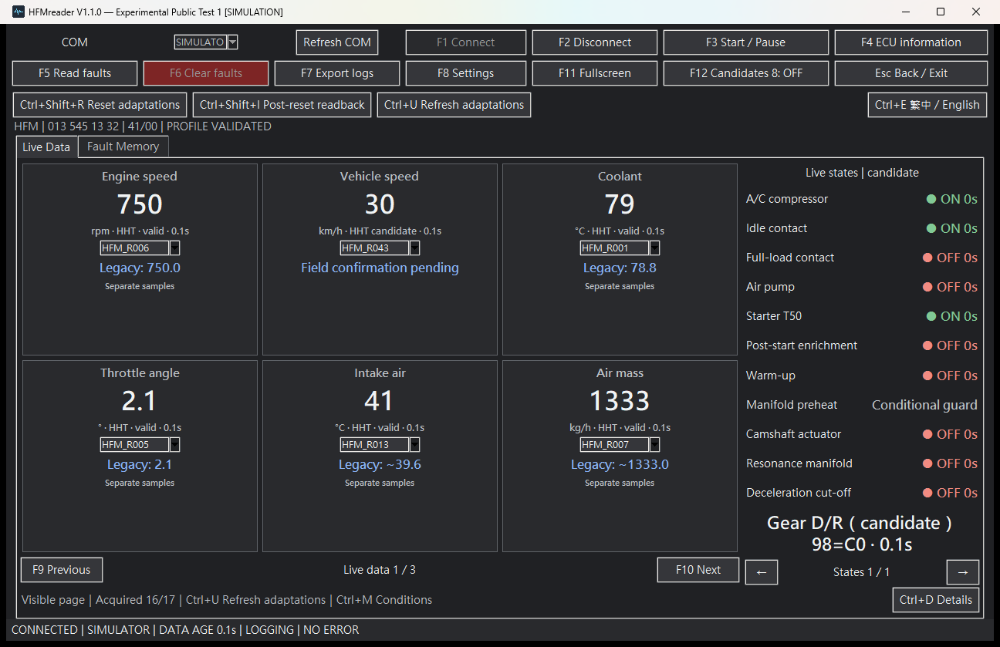
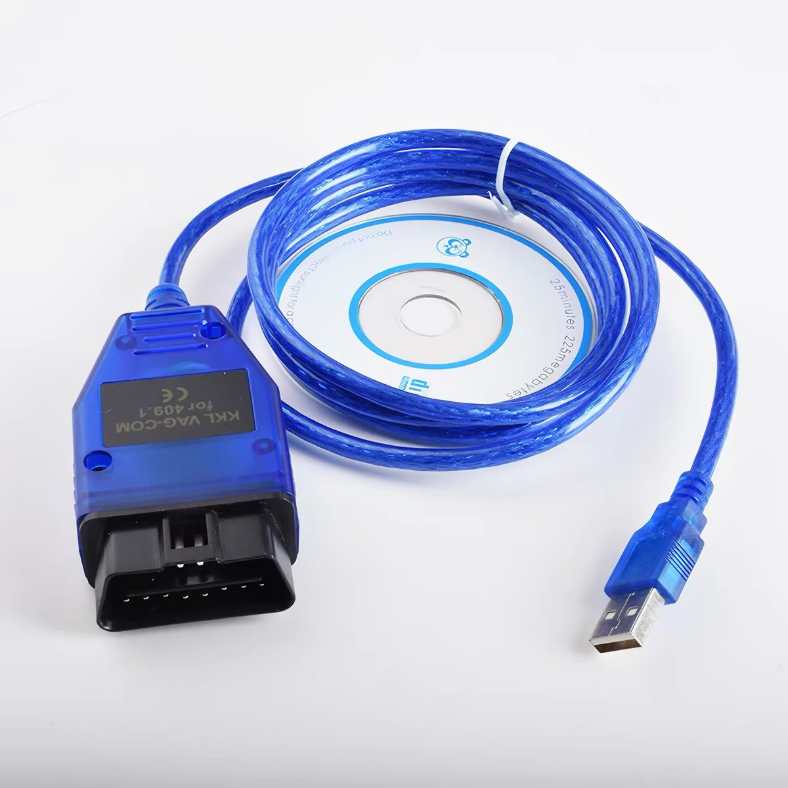
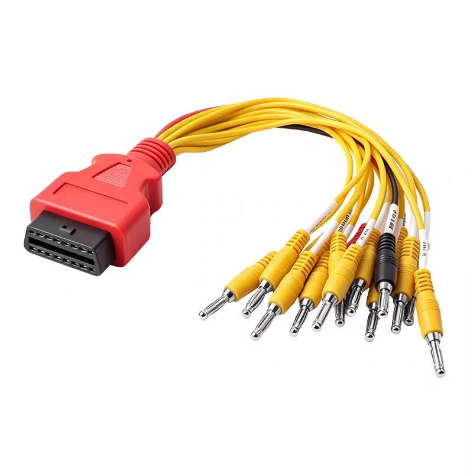
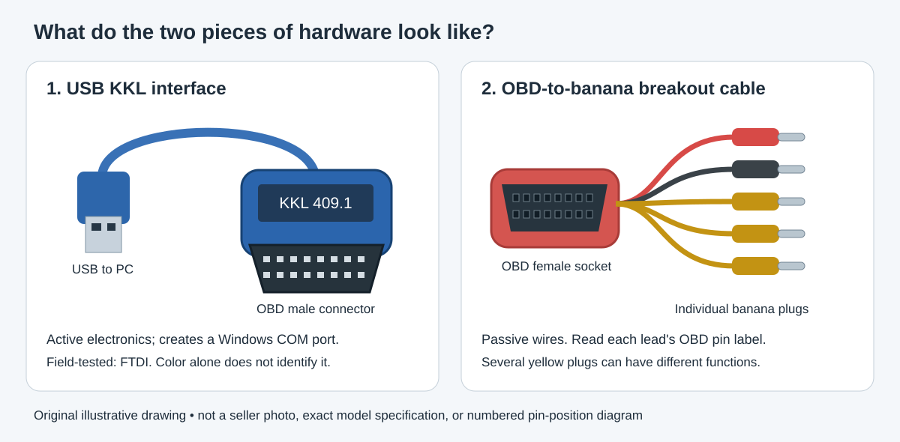
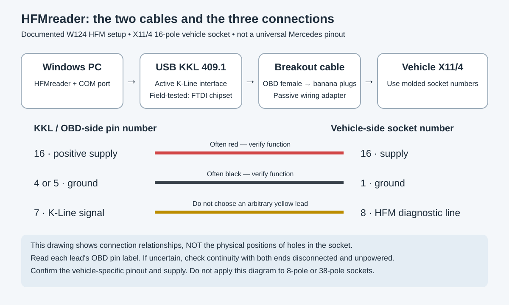

# HFMreader V1.1.1 — Experimental Public Test 2

**繁體中文使用者：請先看[中文操作卡](操作卡_繁體中文.md)。沒有車或線材，也可以執行 `SIMULATE.cmd` 熟悉介面。**

A free Windows tool for Mercedes-Benz owners exploring their Bosch HFM engine-management system. Read live engine data and fault memory, save diagnostic sessions, and help improve compatibility through voluntary test reports.

*Actual application screenshot in simulation mode. These are demonstration values, not measurements from a vehicle.*

## Connection recovery update

This release improves bounded COM cleanup and error evidence. **Vehicle recovery improvement is not yet verified.** See [release notes](RELEASE_NOTES.md).

## Download: one complete ZIP

**[Download HFMreader for Windows x64 (complete ZIP)](https://github.com/pellaeonchi-5566/HFMreader/releases/download/v1.1.1-public.1/HFMreader_1.1.1-public.1_WIN64.zip)** · [Release notes and SHA-256](https://github.com/pellaeonchi-5566/HFMreader/releases/tag/v1.1.1-public.1). Do not download the repository's Source code ZIP as the Windows application. Do not download individual cloud-folder files.

Extract the entire ZIP to a writable folder. Keep **HFMreader.exe and _internal together**. Python installation is not required. Start with CHECK_PC.cmd, then SIMULATE.cmd before connecting a car. Read [QUICK_START.md](QUICK_START.md).

This is an experimental public test release. Internal application version: 1.1.1-public.1. Freeware with privately retained source code, not an open-source release.

**No car or cable yet?** Run `SIMULATE.cmd` to explore the interface with simulated data before buying hardware or connecting a vehicle. Simulation does not test your adapter, wiring or ECU compatibility.

## What you need

- A Windows 10 or 11 x64 computer with a USB port. Adapter and Windows combinations beyond those tested remain unverified.
- A compatible USB **KKL 409.1 K-Line interface**. The field-tested setup uses an FTDI chipset and a Windows COM port. A similar blue case or the same seller label does not guarantee the same electronics. ELM327/Bluetooth adapters are not interchangeable with this interface and are not supported by this build.
- An **OBD female-to-banana breakout cable**, allowing the KKL's power, ground and K-Line to reach the correct vehicle diagnostic sockets. This passive cable is a separate item from the USB KKL interface.
- Correct driver, confirmed COM number, and vehicle-specific wiring information.

### What the two cables look like

**1. USB KKL interface — connects your computer to the diagnostic cable.**

**2. OBD female-to-banana breakout cable — connects the KKL interface to individual vehicle sockets.**

Connect them in this order: **PC USB → KKL interface → breakout cable → vehicle diagnostic sockets**. These original product photos were supplied by Pellaeon Chi as identification references; a matching blue case does not prove an FTDI chipset. Check the chipset, driver and each lead's function. The pictured CD/software is not required or included.

For the documented W124 HFM 16-pole X11/4 setup: **OBD 16 → vehicle 16; OBD 4 or 5 → vehicle 1; OBD 7 → vehicle 8**. These are two different connector numbering systems. Colors alone are insufficient: multi-lead breakout cables often have several yellow plugs. See [HARDWARE_CONNECTION.md](HARDWARE_CONNECTION.md) before connecting.

## What it does

- Displays live data in pages, ECU identification and supported status information.
- Reads DTC numbers, current/stored status and available definitions; preserves raw diagnostic evidence.
- Provides existing DTC-clear and learning-value-reset functions with confirmations and ECU restrictions. Save evidence before clearing; resetting adaptation is a state-changing operation.
- Records and exports local diagnostic logs; includes offline simulation and an installation check.
- Retains the existing 29 HHT runtime records, with conditional applicability and uncertainty indicators. Their presence does not establish validation on every ECU.

No standalone Control Console or new actuator tests are exposed. Keyboard shortcuts are shown in the application.

## What is known — and what is not

The strongest repeated vehicle evidence is **BOSCH 0135451332 / 41/00**. We do not claim support for every M104, M111 or HFM ECU. Communication interruptions, incomplete or incorrect data, and incompatible hardware remain possible. See [KNOWN_ISSUES.md](KNOWN_ISSUES.md).

The independent DTC catalog contains 115 OEM-supported definitions, 13 equipment-reference definitions with scope notes, two supported core meanings with unverified details (107/117), 31 entries marked **Definition not yet verified.**, and two application labels (0/1). An unknown description does not remove the DTC number or block the existing read/clear workflow.

## Contribute Your Test Logs

We welcome voluntary real-vehicle test logs from Mercedes-Benz HFM owners worldwide, not only bug reports. **Even when everything works, your results are valuable**: different ECU revisions, interfaces and operating conditions help us understand compatibility and diagnostic communication.

**Successful, Partially Successful, Failed and Connection Failed** results are all welcome. No extra clear/reset experiment is required. Engineers are also welcome to suggest improvements.

Close HFMreader, run **PACKAGE_RESULTS.cmd**, and review the resulting **HFMreader_RESULTS_*.zip** for personal information. Open [Submit Vehicle Test Results & Logs](https://github.com/pellaeonchi-5566/HFMreader/issues/new?template=vehicle-test.yml), select your result and optionally upload the reviewed ZIP. Complete logs are encouraged whenever you are comfortable sharing them. See [TEST_REPORTING.md](TEST_REPORTING.md).

Logs are submitted voluntarily and are never uploaded automatically. By submitting data, you allow the HFMreader team to analyze it for ECU compatibility, diagnostic protocols and communication problems. Public Issue attachments can be accessed by other people. You may omit attachments; agree on a private transfer method with the maintainer before sending private files. Further public sharing of your original personal logs by the team will remain within your consent; submission is not blanket permission to republish them elsewhere.

## Free use and acknowledgments

Personal use and ordinary professional diagnostics are free, including repair shops charging normal labor fees. Unauthorized resale or rebranding of HFMreader is not permitted under the HFMreader Free-Use Terms. Read [FREE_USE_TERMS.md](FREE_USE_TERMS.md) and [THIRD_PARTY_NOTICES.md](THIRD_PARTY_NOTICES.md). Optional sponsorship details may be added later.

This independent project is not affiliated with or endorsed by Mercedes-Benz, Bosch, FTDI or the adapter manufacturer.

Author: **Pellaeon Chi**. Copyright (c) 2026 Pellaeon Chi in original HFMreader material; third-party notices remain applicable.
